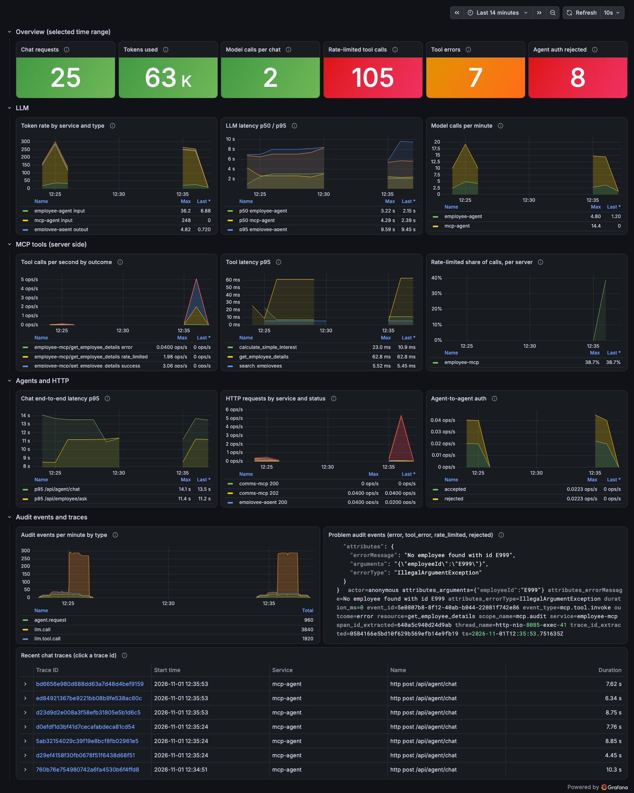
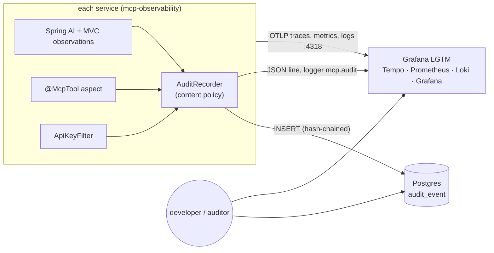
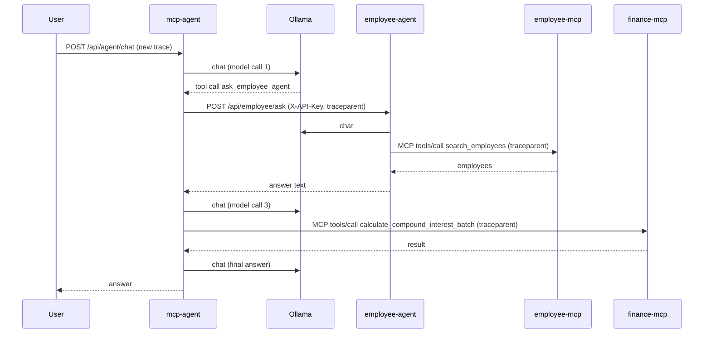
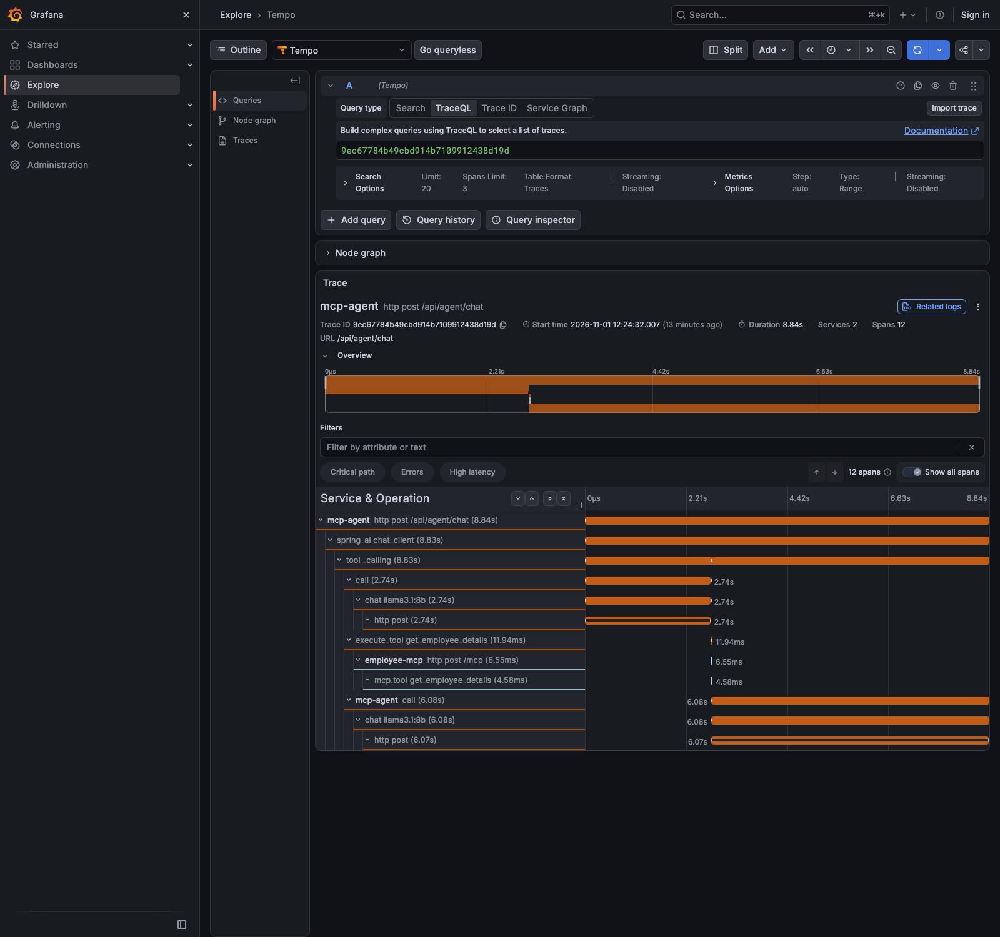
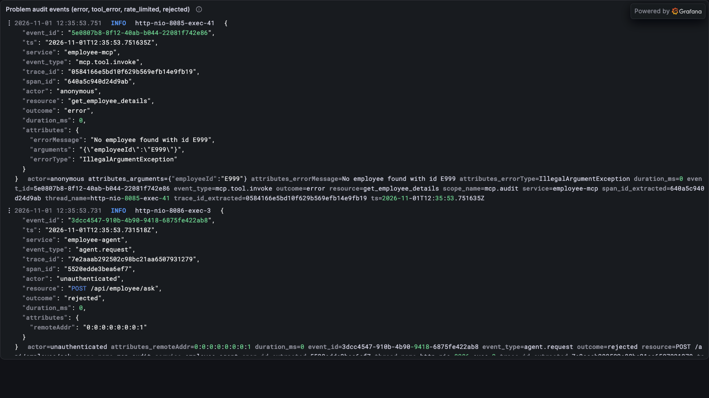
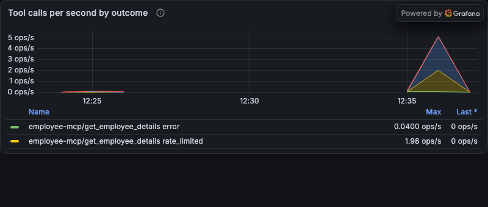
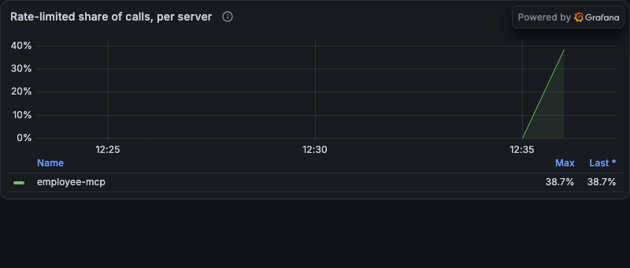
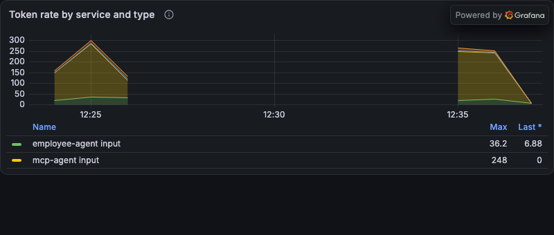
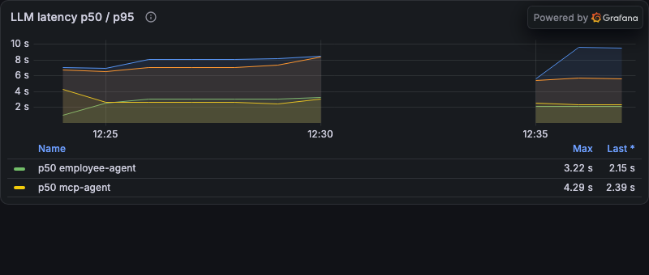

# Telemetry Guide: design, implementation, signals and what to look for

How the agents and MCP servers are observed and audited, what each signal means, and how to read the
dashboard. For the short version see [ARCHITECTURE.md §11](../ARCHITECTURE.md#11-observability--audit); for
commands to start things see [README → Observability & audit](../README.md#observability--audit).

> **Status.** Everything here was run against the real stack (Ollama `llama3.1:8b`, Grafana LGTM 0.39.0,
> Postgres 17). Where something is a proposal rather than built, it says so. The screenshots are real, taken
> from that run with the load script in `observability/load/`; the numbers in them are demo-scale.

## Contents

1. [The 60-second version](#1-the-60-second-version)
2. [Design](#2-design)
3. [Implementation](#3-implementation)
4. [Signal catalogue](#4-signal-catalogue)
5. [The dashboard](#5-the-dashboard)
6. [What to look for (playbook)](#6-what-to-look-for-playbook)
7. [Query cookbook](#7-query-cookbook)
8. [Proposed alerts (not built)](#8-proposed-alerts-not-built)
9. [Reproducing this locally](#9-reproducing-this-locally)
10. [Limitations and troubleshooting](#10-limitations-and-troubleshooting)

---

## 1. The 60-second version

- Every service exports **traces, metrics and logs** over OTLP to one local Grafana stack. One user question
  produces **one trace** that crosses `mcp-agent` → `employee-agent` → `employee-mcp` / `finance-mcp`.
- Separately, every model call, tool call and agent-to-agent request is written as an **audit event**: to Loki
  (for developers) and to an **append-only, hash-chained Postgres table** (for compliance).
- **Prompts, completions and tool data never appear in traces or metrics.** They live only in the audit sinks,
  under a content policy (`full` in dev, `redacted` otherwise).
- One shared library, `mcp-observability`, does all of it. A service adds one dependency and some YAML.



---

## 2. Design

### 2.1 Two jobs, two mechanisms

|                        | Debugging signals                               | Audit trail                                                                         |
|------------------------|-------------------------------------------------|-------------------------------------------------------------------------------------|
| Question               | "Why was this request slow, wrong or rejected?" | "What did the model and tools do with which data, and has the record been altered?" |
| Transport              | OTLP → Tempo, Prometheus, Loki                  | `AuditRecorder` → Loki line **and** Postgres row                                    |
| Sampling               | Sampled (100 % in dev)                          | Never sampled                                                                       |
| Retention              | Short, tunable                                  | Long, governed                                                                      |
| Mutable                | Yes                                             | No (triggers + hash chain)                                                          |
| Holds prompt/tool text | **Never**                                       | Per content policy                                                                  |

Mixing them is the usual mistake: traces are lossy and mutable, which is wrong for compliance, and putting
sensitive text in traces turns the trace backend into an uncontrolled PII store.

### 2.2 Architecture



### 2.3 Request flow and trace shape


Every arrow carries the same W3C `traceparent`, so Tempo shows one tree. Each model call, tool call and
hop also writes one audit event with the same `trace_id`.

### 2.4 Design decisions

| Decision                                                       | Reason                                                                            | Cost                                                           |
|----------------------------------------------------------------|-----------------------------------------------------------------------------------|----------------------------------------------------------------|
| Hook Spring AI's **observations** (not a `ChatClient` advisor) | Fires for every round-trip inside the tool-calling loop; no changes to agent code | Tied to Spring AI's context classes                            |
| **Aspect** on `@McpTool`                                       | Covers every current and future tool; sees the rate-limit exception               | Needs AspectJ on the MCP servers                               |
| One shared **library**                                         | Same behaviour in every service; one place for the content policy                 | A new module to version                                        |
| **Content only in audit sinks**                                | Keeps PII out of the trace backend                                                | Debugging from traces alone shows no text; use the audit event |
| **Postgres hash chain** + triggers                             | Tamper-evident, queryable, no extra infrastructure                                | Writes are serialised; superuser can still rewrite (see §10)   |
| **Fail-open** auditing                                         | An audit outage must not take down user requests                                  | A gap is possible; it is logged                                |
| OTLP everywhere                                                | Vendor-neutral: swap Grafana for another backend by changing an endpoint          | None significant                                               |

### 2.5 Content policy

| Where                 | Prompt / completion / tool args + results                                                                                |
|-----------------------|--------------------------------------------------------------------------------------------------------------------------|
| Traces, metrics       | Never. Spring AI's content flags are explicitly `false`                                                                  |
| Audit sinks           | `mcp.audit.content=full` stores the text (truncated at 20 000 chars, flagged). `redacted` stores only SHA-256 and length |
| Console and OTLP logs | Only if you raise Spring AI / MCP loggers to `DEBUG`. They are `INFO`; `DEBUG` would bypass the policy                   |

In `full` mode names, dates of birth and salaries are stored in Loki and Postgres. Treat both as PII stores.

---

## 3. Implementation

### 3.1 Module map

`mcp-observability/src/main/java/com/milind/mcpobservability/`

| Class                                                               | What it does                                                                                                                                            |
|---------------------------------------------------------------------|---------------------------------------------------------------------------------------------------------------------------------------------------------|
| `ObservabilityAutoConfiguration`                                    | Registers everything. Each capture point is `@ConditionalOnClass`, so an MCP server gets the aspect and an agent gets the LLM handlers                  |
| `audit/AuditRecorder`                                               | Entry point. Applies the content policy, fills `trace_id`/`span_id`, fans out to sinks, swallows sink failures                                          |
| `audit/LogAuditSink`                                                | One JSON line on logger `mcp.audit` (becomes a Loki line)                                                                                               |
| `audit/JdbcAuditSink`                                               | Appends to `audit_event` inside a transaction holding an advisory lock, so the chain stays linear across JVMs                                           |
| `audit/AuditChain`                                                  | `hash = SHA-256(prev_hash ‖ id ‖ ts ‖ service ‖ event_type ‖ trace_id ‖ span_id ‖ actor ‖ resource ‖ outcome ‖ duration_ms ‖ payload)` and the verifier |
| `audit/AuditChainEndpoint`                                          | `GET /actuator/auditchain` (off by default)                                                                                                             |
| `llm/LlmAuditObservationHandlers`                                   | `Chat`: one `llm.call` per model round-trip. `Tool`: one `llm.tool.call` per tool the model used                                                        |
| `tool/McpToolAuditAspect`                                           | Around every `@McpTool`: span `mcp.tool <name>`, timer `mcp.tool.call`, event `mcp.tool.invoke`                                                         |
| `mcp/TraceContextClientCustomizer` + `TraceparentRequestCustomizer` | Carry `traceparent` into MCP HTTP requests                                                                                                              |
| `resources/logback-spring.xml`                                      | Adds the OpenTelemetry appender next to the console appender                                                                                            |

Also changed outside the library: `ApiKeyFilter` (`employee-agent`) writes `agent.request` events and the
`agent.auth` counter; `observability/` holds the compose file, SQL and dashboard.

### 3.2 How each signal is produced

| Signal                                                                                           | Produced by                                                              |
|--------------------------------------------------------------------------------------------------|--------------------------------------------------------------------------|
| HTTP server spans and `http_server_requests_*`                                                   | Spring MVC / Micrometer (automatic)                                      |
| `chat <model>`, `execute_tool`, `spring_ai chat_client` spans; `gen_ai_*`, `spring_ai_*` metrics | Spring AI observations (automatic once a tracer is present)              |
| `mcp.tool <name>` span, `mcp_tool_call_*` metric, `mcp.tool.invoke` event                        | `McpToolAuditAspect`                                                     |
| `llm.call`, `llm.tool.call` events                                                               | `LlmAuditObservationHandlers` reading the finished Spring AI observation |
| `agent.request` event, `agent_auth_total`                                                        | `ApiKeyFilter`                                                           |
| Log records with `trace_id`                                                                      | Logback → OpenTelemetry appender → OTLP                                  |

### 3.3 Trace propagation: the part that does not work by default

| Hop                                   | Mechanism                                                                              | Notes                |
|---------------------------------------|----------------------------------------------------------------------------------------|----------------------|
| Browser/curl → `mcp-agent`            | New trace starts here                                                                  |                      |
| `mcp-agent` → `employee-agent` (REST) | `RestClient.Builder` from Spring is instrumented, so `traceparent` is sent             | Nothing extra needed |
| Agent → MCP server                    | **Custom.** The MCP client uses the JDK `HttpClient`, which Spring does not instrument | See below            |
| Inbound at any service                | Spring MVC extracts `traceparent`                                                      | Automatic            |

Reading the current span inside the MCP SDK's request customizer **did not work**: the request is built on a
Reactor thread with no span, so each MCP server started its own trace (observed: different trace ids for the
same question). The fix is a pair. `TraceContextClientCustomizer` sets the SDK's `transportContextProvider`,
which *is* evaluated on the calling thread, and captures the `traceparent` there. `TraceparentRequestCustomizer`
copies it onto the HTTP request. It relies on the **SYNC** MCP client.

### 3.4 Configuration reference

Per service, in `application.yml` (already added to all six modules):

| Property                                                                                                   | Default                                            | Meaning                                                                   |
|------------------------------------------------------------------------------------------------------------|----------------------------------------------------|---------------------------------------------------------------------------|
| `management.tracing.sampling.probability`                                                                  | `1.0`                                              | Fraction of traces kept. Use tail sampling in the collector in production |
| `management.opentelemetry.tracing.export.otlp.endpoint`                                                    | `${OTLP_ENDPOINT:http://localhost:4318}/v1/traces` |                                                                           |
| `management.opentelemetry.logging.export.otlp.endpoint`                                                    | `…/v1/logs`                                        |                                                                           |
| `management.otlp.metrics.export.url` / `.step`                                                             | `…/v1/metrics` / `10s`                             | Metrics are pushed every 10 s                                             |
| `mcp.audit.content`                                                                                        | `full` (`AUDIT_CONTENT`)                           | `full` or `redacted`                                                      |
| `mcp.audit.max-content-chars`                                                                              | `20000`                                            | Per-field cap; adds `…Truncated` and `…Chars`                             |
| `mcp.audit.log.enabled`                                                                                    | `true`                                             | Loki sink                                                                 |
| `mcp.audit.jdbc.enabled`                                                                                   | `false` (`AUDIT_JDBC_ENABLED`)                     | Postgres sink                                                             |
| `mcp.audit.jdbc.url` / `.username` / `.password`                                                           | local dev values                                   | `AUDIT_JDBC_URL`, `AUDIT_JDBC_USER`, `AUDIT_JDBC_PASSWORD`                |
| `spring.ai.chat.observations.log-prompt`, `log-completion`; `spring.ai.tools.observations.include-content` | `false`                                            | Keep content off spans/logs                                               |

### 3.5 Audit table

`observability/postgres-init/001-audit.sql`: `audit_event(seq, id, ts, service, event_type, trace_id, span_id,
actor, resource, outcome, duration_ms, payload, prev_hash, hash)`.

- `payload` is JSON **text**, kept verbatim so the hash can be recomputed (`payload::jsonb` to query it).
- Triggers raise on `UPDATE`, `DELETE`, `TRUNCATE`. The services connect as `audit_writer` (`INSERT`, `SELECT`).
- Timestamps are truncated to microseconds before hashing, because Postgres stores microseconds.
- The applications never run DDL.

---

## 4. Signal catalogue

### 4.1 Metrics

All names are the Prometheus names as seen in this stack (OTLP → Prometheus converts dots to underscores and
adds the unit). Latency histograms are in **milliseconds** and come as `_bucket`, `_count`, `_sum`, `_max`.

| Metric                                   | Type      | Key labels                                                                             | Source               | Tells you                                                                                          |
|------------------------------------------|-----------|----------------------------------------------------------------------------------------|----------------------|----------------------------------------------------------------------------------------------------|
| `gen_ai_client_token_usage_total`        | counter   | `service_name`, `gen_ai_request_model`, `gen_ai_token_type` = `input`/`output`/`total` | Spring AI            | Cost. Input dominates: every call resends the system prompt and tool schemas                       |
| `gen_ai_client_operation_milliseconds_*` | histogram | `service_name`, `gen_ai_request_model`, `error`                                        | Spring AI            | Latency and count of model calls                                                                   |
| `spring_ai_chat_client_milliseconds_*`   | histogram | `service_name`                                                                         | Spring AI            | A whole `ChatClient` call, including tool loops                                                    |
| `spring_ai_tool_milliseconds_*`          | histogram | `service_name`, `spring_ai_tool_definition_name`                                       | Spring AI            | Tool calls as the **model side** sees them (includes network)                                      |
| `spring_ai_advisor_milliseconds_*`       | histogram | advisor name                                                                           | Spring AI            | Time in `ChatClient` advisors                                                                      |
| `mcp_tool_call_milliseconds_*`           | histogram | `mcp_server`, `mcp_tool`, `outcome` = `success`/`error`/`rate_limited`, `service_name` | `McpToolAuditAspect` | Tool calls as the **server side** sees them. The reliable error and rate-limit signal              |
| `agent_auth_total`                       | counter   | `outcome` = `accepted`/`rejected`                                                      | `ApiKeyFilter`       | Agent-to-agent auth failures                                                                       |
| `http_server_requests_milliseconds_*`    | histogram | `service_name`, `uri`, `method`, `status`, `outcome`                                   | Spring MVC           | Request rate, errors, latency per endpoint. Note: 401s from the filter appear with `uri="UNKNOWN"` |
| `http_client_requests_milliseconds_*`    | histogram | `uri`, `status`, `client_name`                                                         | Spring               | Outbound REST (the `employee-agent` call)                                                          |
| `jvm_*`, `process_cpu_usage`, …          | gauge     | `service_name`                                                                         | Micrometer           | Standard JVM and process health                                                                    |

> `spring_ai_tool_*` and `mcp_tool_call_*` measure the same call from two ends. Compare them: a large gap is
> network or serialisation time. And only `mcp_tool_call_*` marks errors, because of the next point.

**Important blind spot.** When an MCP server returns an error result (invalid arguments, a rate-limit
rejection), Spring AI does not throw: it hands the model the string `Error calling tool: …`. The model-side
span and `spring_ai_tool_*` metric therefore still say success. Use `mcp_tool_call_milliseconds_count{outcome!="success"}`
and the audit event outcome `tool_error`.

### 4.2 Traces

| Span name                     | Service                   | Attributes worth knowing                                                                                                                                                    |
|-------------------------------|---------------------------|-----------------------------------------------------------------------------------------------------------------------------------------------------------------------------|
| `http post /api/agent/chat`   | mcp-agent                 | Root of a user question                                                                                                                                                     |
| `spring_ai chat_client`       | mcp-agent, employee-agent | Whole tool-calling loop                                                                                                                                                     |
| `chat <model>`                | agents                    | `gen_ai.request.model`, `gen_ai.request.temperature`, `gen_ai.usage.input_tokens`, `…output_tokens`, `gen_ai.response.finish_reasons`, `spring.ai.model.request.tool.names` |
| `execute_tool <name>`         | agents                    | `spring.ai.tool.call.id`, tool definition name/description/schema. **No arguments or results**                                                                              |
| `http post /api/employee/ask` | employee-agent            | Child of the calling agent's tool span                                                                                                                                      |
| `http post /mcp`              | MCP servers               | Child of the caller's `execute_tool` span                                                                                                                                   |
| `mcp.tool <name>`             | MCP servers               | Tag `outcome`; error recorded on the span for `error`                                                                                                                       |



### 4.3 Logs

Console pattern includes the trace and span id: `[employee-mcp] [ … ] [<traceId>-<spanId>]`. In Loki the
stream label is `service_name`; `trace_id`, `span_id`, `scope_name`, `severity_text`, `thread_name` are
structured metadata. Audit events are the lines whose `scope_name` is `mcp.audit`.

### 4.4 Audit events

Common fields: `event_id`, `ts`, `service`, `event_type`, `trace_id`, `span_id`, `actor`, `resource`,
`outcome`, `duration_ms`, `attributes`.

| `event_type`      | `resource`     | `outcome` values                   | `attributes`                                                                                                                                         |
|-------------------|----------------|------------------------------------|------------------------------------------------------------------------------------------------------------------------------------------------------|
| `llm.call`        | model name     | `success`, `error`                 | `prompt` (all messages), `completion`, `requestedToolCalls`, `inputTokens`, `outputTokens`, `finishReason`, `provider`, `responseModel`, `streaming` |
| `llm.tool.call`   | tool name      | `success`, `error`, `tool_error`   | `arguments`, `result`, `toolCallId`, `toolType`                                                                                                      |
| `mcp.tool.invoke` | tool name      | `success`, `error`, `rate_limited` | `arguments`, `result`, `errorType`, `errorMessage`                                                                                                   |
| `agent.request`   | `METHOD /path` | `accepted`, `rejected`             | `remoteAddr`                                                                                                                                         |

Under `mcp.audit.content=redacted` each content field `x` becomes `xSha256` and `xChars`.



---

## 5. The dashboard

Provisioned automatically when the stack starts: **Grafana → Dashboards → "MCP Agent Demo - Telemetry"**
(`observability/grafana/dashboards/mcp-agent-telemetry.json`, uid `mcp-agent-telemetry`). Direct link:
http://localhost:3000/d/mcp-agent-telemetry. Every query was run against the live stack and returned data.

| Row         | Panel                               | Query idea                                             | Read it as                                                 |
|-------------|-------------------------------------|--------------------------------------------------------|------------------------------------------------------------|
| Overview    | Chat requests, Tokens used          | `increase(...)` over the selected range                | Volume and cost                                            |
| Overview    | **Model calls per chat**            | model calls ÷ chat requests                            | ~2 normal. Climbing = loops or retries (turns orange at 4) |
| Overview    | **Rate-limited tool calls**         | `mcp_tool_call…{outcome="rate_limited"}`               | Red at ≥ 1. Should be 0                                    |
| Overview    | Tool errors, Agent auth rejected    | outcome `error`; `agent_auth_total{rejected}`          | Bad input / bad key                                        |
| LLM         | Token rate by service and type      | `rate(gen_ai_client_token_usage_total)`                | Which agent spends tokens, input vs output                 |
| LLM         | LLM latency p50 / p95               | `histogram_quantile` on operation buckets              | Model slowness                                             |
| LLM         | Model calls per minute              | operation count rate                                   | Pairs with the chat rate                                   |
| MCP tools   | Tool calls per second by outcome    | `mcp_tool_call…` by tool and outcome                   | Load and failures per tool                                 |
| MCP tools   | Tool latency p95                    | tool buckets                                           | Slow tools                                                 |
| MCP tools   | Rate-limited share per server       | rejected ÷ all                                         | Limit pressure                                             |
| Agents/HTTP | Chat end-to-end p95                 | `/api/agent/chat`, `/api/employee/ask`                 | What users wait for                                        |
| Agents/HTTP | HTTP requests by service and status | `http_server_requests`                                 | 401/400/5xx                                                |
| Agents/HTTP | Agent-to-agent auth                 | `agent_auth_total`                                     | accepted vs rejected                                       |
| Audit       | Audit events per minute by type     | Loki `count_over_time`                                 | Audit pipeline is alive                                    |
| Audit       | Problem audit events                | Loki, outcome ∈ error/tool_error/rate_limited/rejected | Open a line for arguments and `trace_id`                   |
| Audit       | Recent chat traces                  | Tempo TraceQL                                          | Click a trace id to open the waterfall                     |

**Sample panels (real data from the load script).**

| Tool calls by outcome                      | Rate-limited share                                 |
|--------------------------------------------|----------------------------------------------------|
|  |  |

| Token rate                             | LLM latency                                  |
|----------------------------------------|----------------------------------------------|
|  |  |

---

## 6. What to look for (playbook)

Read the shape, not just the number. The sketches are **illustrative** (not real data); the screenshots above
are real.

### 6.1 Symptom → where to look

| Symptom                                  | First look                                                                               | Healthy                              | Unhealthy                                                           | Then                                                                                           |
|------------------------------------------|------------------------------------------------------------------------------------------|--------------------------------------|---------------------------------------------------------------------|------------------------------------------------------------------------------------------------|
| "The agent is slow"                      | Chat latency p95; then trace waterfall                                                   | Time spread across a few model calls | One bar dominates (a model call, or a tool)                         | Model call: check input tokens. Tool: `mcp_tool_call` p95 vs `spring_ai_tool` p95              |
| "The answer is wrong but nothing failed" | Audit `llm.call` for the trace: `prompt`, `requestedToolCalls`; `llm.tool.call` `result` | Tool args match the question         | Model sent malformed args, or ignored a tool result                 | Audit `outcome=tool_error`; consider a prompt or tool-description fix (the planned eval suite) |
| Tokens/cost rising                       | Token rate (input vs output); model calls per chat                                       | Flat per chat                        | Step up with flat traffic = prompt/tool-schema change. Ramp = loops | Compare traces before/after; check `finishReason` and `spring.ai.model.request.tool.names`     |
| Looping agent                            | **Model calls per chat**, `llm.call` count per `trace_id`                                | ~2–3                                 | 4+ and growing, repeated identical tool calls                       | Open a trace; look for the same `execute_tool` repeating                                       |
| Rate limiting                            | Rate-limited stat and share panel                                                        | 0                                    | Sustained > 0, or short sharp bursts                                | Burst = client fan-out (batch it). Sustained = limit too low or a runaway caller               |
| Auth failures                            | Agent auth rejected; HTTP 401                                                            | ~0                                   | Any steady rate                                                     | Key mismatch between agents, or probing. Check `agent.request` `remoteAddr`                    |
| A tool keeps erroring                    | Tool calls by outcome (`error`)                                                          | None                                 | One tool with `error`                                               | Audit `mcp.tool.invoke` `errorMessage` and `arguments`                                         |
| "Did anyone tamper with the audit log?"  | `/actuator/auditchain`                                                                   | `valid: true`                        | `valid: false` + `firstBrokenSeq`                                   | Treat as an incident; see §10                                                                  |

### 6.2 Shapes

**Healthy chat traffic**: steady, small, model calls track chats.
```
chats / min      ▃▅▃▄▅▃▄▅▃▄          model calls/min  ▆▇▆▆▇▆▆▇▆▆   (≈ 2–3× chats)
```

**Looping agent**: chats flat, model calls and input tokens climb together.
```
chats / min      ▃▄▃▄▃▄▃▄▃▄          model calls/min  ▃▃▄▅▆▇▇▇██   input tokens  ▂▃▄▅▆▇███
```

**Prompt/tool-schema change**: a step in input tokens at the deploy, nothing else moves.
```
input tokens     ▃▃▃▃▃▃█████████     chats / min      ▃▄▃▄▃▄▃▄▃▄   ← deploy here
```

**Rate-limit burst (client fan-out)**: a short spike of `rate_limited` right after a spike of calls.
```
calls / s        ▁▁▁▁█▁▁▁▁▁▁▁        rate_limited / s ▁▁▁▁▇▁▁▁▁▁▁▁   (the burst of 100 is allowed, the rest is rejected)
```

**Runaway caller**: `rate_limited` sustained, success pinned near the limit.
```
success / s      ▇▇▇▇▇▇▇▇▇▇▇▇        rate_limited / s ▅▆▇▇▇▇▇▇▇▇▇▇
```

**Dependency down** (e.g. employee-agent): `error`/5xx on the calling agent, no spans below the failing hop.

### 6.3 Reading one trace

1. Open a trace from **Recent chat traces**.
2. Find the widest bar. If it is `chat <model>`, look at its `gen_ai.usage.input_tokens`.
3. Count `chat` spans. More than ~3 for a simple question means extra tool rounds.
4. Compare an agent's `execute_tool` span with the `mcp.tool` span below it: the gap is network and serialisation.
5. Take the `trace_id` to Loki or SQL for the **content** (prompt, completion, tool arguments and results).

---

## 7. Query cookbook

**PromQL**
```promql
# tokens per second by service and direction
sum by (service_name, gen_ai_token_type) (rate(gen_ai_client_token_usage_total{gen_ai_token_type!="total"}[1m]))
# model calls per chat (should be ~2-3)
sum(increase(gen_ai_client_operation_milliseconds_count{service_name="mcp-agent"}[15m]))
  / sum(increase(http_server_requests_milliseconds_count{uri="/api/agent/chat"}[15m]))
# LLM latency p95
histogram_quantile(0.95, sum by (le, service_name) (rate(gen_ai_client_operation_milliseconds_bucket[5m])))
# tool outcomes
sum by (mcp_server, mcp_tool, outcome) (rate(mcp_tool_call_milliseconds_count[1m]))
# rate-limited share
sum by (mcp_server) (rate(mcp_tool_call_milliseconds_count{outcome="rate_limited"}[1m]))
  / sum by (mcp_server) (rate(mcp_tool_call_milliseconds_count[1m]))
# auth rejections
sum by (outcome) (rate(agent_auth_total[1m]))
```

**LogQL**
```logql
# full prompt and completion of every model call
{service_name=~".+"} | scope_name="mcp.audit" | json | event_type="llm.call"
# everything that went wrong
{service_name=~".+"} | scope_name="mcp.audit" | json | outcome=~"error|tool_error|rate_limited|rejected"
# all log lines for one request
{service_name=~".+"} | trace_id="<trace id>"
```

**TraceQL**
```traceql
{ resource.service.name = "mcp-agent" && name = "http post /api/agent/chat" }
{ resource.service.name = "mcp-agent" && name = "http post /api/agent/chat" && duration > 10s }
# model calls with 4+ digit input tokens (Spring AI stores token counts as strings, so numeric > does not match)
{ span.gen_ai.usage.input_tokens =~ "[0-9]{4,}" }
```

**SQL (audit)**
```sql
-- one request, in order
select seq, service, event_type, resource, outcome, duration_ms
from audit_event where trace_id = '<trace id>' order by seq;
-- who hit the rate limit
select ts, service, resource from audit_event where outcome = 'rate_limited' order by seq desc limit 20;
-- salary lookups by tool calls (full-content mode)
select ts, resource, payload::jsonb->>'arguments' from audit_event
where event_type = 'mcp.tool.invoke' and payload::jsonb->>'result' like '%salary%' order by seq desc;
```

---

## 8. Proposed alerts (not built)

Starting thresholds to tune against real traffic; nothing here is configured.

| Alert                   | Expression idea                                                   | Why                                |
|-------------------------|-------------------------------------------------------------------|------------------------------------|
| Looping agent           | model calls per chat > 5 for 10 min                               | Cost and latency runaway           |
| Token spike             | input tokens/s > 3× the 1-day median                              | Prompt or tool-schema regression   |
| Sustained rate limiting | rate-limited share > 5 % for 5 min                                | Limit too low or runaway caller    |
| Tool errors             | `mcp_tool_call…{outcome="error"}` rate > 0.1/s for 10 min         | Broken tool or bad model arguments |
| Auth failures           | `agent_auth_total{outcome="rejected"}` > 0 for 5 min              | Key drift or probing               |
| Chat latency            | p95 `/api/agent/chat` > 30 s                                      | User impact                        |
| Audit pipeline stalled  | no `agent.request`/`llm.call` events for 15 min while chats occur | Gap in the audit trail             |
| Audit chain broken      | `/actuator/auditchain` `valid=false` (scheduled check)            | Tampering or corruption            |

---

## 9. Reproducing this locally

```bash
docker compose -f observability/docker-compose.yml up -d      # Grafana :3000, OTLP :4318, Postgres :5432
export AUDIT_JDBC_ENABLED=true                                 # in every service terminal
# start the services as in the README, then:
observability/load/generate-load.sh                            # ~5 min of mixed traffic incl. 401s, errors, 2 rate-limit bursts
```
Open http://localhost:3000/d/mcp-agent-telemetry. Allow ~15 s after the first traffic for metrics to appear
(10 s export interval), and a few minutes of load before the latency percentile panels fill in: a `rate()` over a
histogram needs at least two samples that changed.

Tests: `mvn test -pl mcp-observability` (15 tests: hash chain tamper/delete/empty, content policy, aspect
outcomes, tool-error classification).

---

## 10. Limitations and troubleshooting

**Known limitations**

- **No end-user identity.** `mcp-agent` is unauthenticated, so `actor` is `anonymous` on model and tool events.
- **Fail-open** auditing, **synchronous** and **serialised** Postgres writes.
- A database **superuser can disable the triggers and rewrite and re-hash the tail**; deleting the newest rows is
  detectable only against an externally stored head hash.
- `spring_ai_tool_*` and the `execute_tool` span show **success for MCP error results** (see §4.1). The
  `tool_error` audit outcome relies on a prefix match of Spring AI's wording.
- Sampling is 100 %; no alerts are configured; no "tool calls per question" metric (derive it from traces).
- MCP propagation requires the SYNC MCP client. `general-purpose-mcp` is not instrumented.

**Troubleshooting**

| Problem                                            | Cause / fix                                                                                                       |
|----------------------------------------------------|-------------------------------------------------------------------------------------------------------------------|
| No data in Grafana                                 | Services export to `localhost:4318`; check the stack is up and `OTLP_ENDPOINT`                                    |
| Latency percentile panels empty                    | Not enough continuous traffic; run the load script for a few minutes                                              |
| MCP server spans are in a *different* trace        | `TraceContextClientCustomizer` not active (ASYNC client, or `mcp-observability` missing)                          |
| No `/v1/logs` / no `trace_id` in Loki              | `opentelemetry-logback-appender` missing from the jar, or the service ships its own `logback-spring.xml`          |
| App starts but build lacks OTel jars               | Stale root pom in `~/.m2`: run `mvn -pl mcp-observability -am install -DskipTests`                                |
| `exec format error` starting LGTM on Apple Silicon | Compose pins `platform: linux/amd64`; keep it                                                                     |
| Postgres sink errors in the log                    | Table missing (`observability/postgres-init/001-audit.sql` only runs on a fresh volume: `docker compose down -v`) |
| Port already in use                                | Another process holds 8080/8083/8084; stop it or override `--server.port`                                         |
